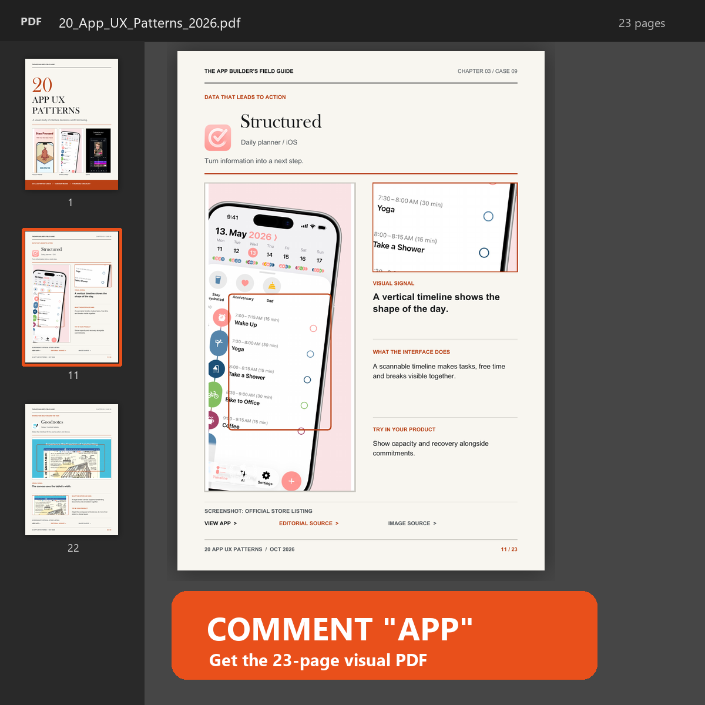

# 20 App UX Patterns Worth Studying

A 23-page visual field guide for app builders: 20 real products, five themes, and a full-page illustrated analysis for every case. Each case pairs an official store screenshot with a marked detail, a magnified crop, and one idea to test in your own product.

**[Download the PDF](20_App_UX_Patterns_2026.pdf)**

## What is inside

1. One clear promise
2. Complex work, simple flow
3. Data that leads to action
4. Design for more people
5. Interaction built around the task

Each case links to the official App Store or Google Play listing, its screenshot source, and the relevant Apple or Google editorial source. The patterns are our design interpretation; they are not claims about revenue, conversion, or product performance. App interfaces can change.

Research checked: 15 October 2026.

Sources: [Apple Design Awards 2026](https://developer.apple.com/design/awards/), [Apple Design Awards 2025](https://developer.apple.com/design/awards/2025/), [Google Play Best of 2025](https://blog.google/products-and-platforms/platforms/google-play/best-apps-games-2025/).
